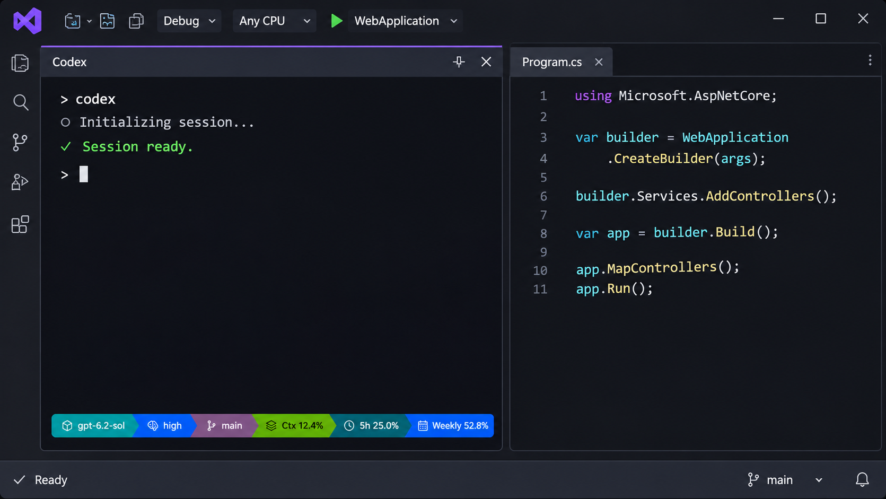

<div align="center">

# 

**Your Codex terminal. Your Powerline layout. Inside Visual Studio.**

Run Codex Powerline in a dockable Visual Studio tool window, with the same
model, context, usage limits, Git widgets, themes, and saved layouts as the CLI.

**Also supported in**

<a href="https://github.com/powerline-dev/codex-powerline-cli"> CLI</a> &nbsp; · &nbsp; <a href="https://github.com/powerline-dev/codex-powerline-vscode"> VS Code</a>

One Powerline CLI. The same layouts, themes, and widgets across all three hosts.

Give a ⭐ if this project helped you!

[](https://github.com/powerline-dev/codex-powerline-visualstudio)
[](https://github.com/powerline-dev/codex-powerline-visualstudio/forks)
[](https://github.com/powerline-dev/codex-powerline-visualstudio)

[](https://github.com/powerline-dev/codex-powerline-visualstudio/blob/main/LICENSE)
[](https://visualstudio.microsoft.com/)
[](https://nodejs.org/)

[](https://github.com/powerline-dev/codex-powerline-visualstudio/issues)
[](https://github.com/powerline-dev/codex-powerline-visualstudio/pulls)
[](https://github.com/powerline-dev/codex-powerline-visualstudio/graphs/contributors)



</div>

## 📥 Install

### 🪟 Windows x64

Use **Visual Studio 2022 17.14 or newer**, or **Visual Studio 2026**, in Community,
Professional, or Enterprise edition. This is not a VS Code extension.
Native ARM64 Visual Studio is not included in this release.

**📦 Install and launch**

Install [x64 Node.js 22.12 or newer](https://nodejs.org/en/download). In PowerShell, run:

```powershell
npm install --global @openai/codex @powerline-dev/codex-powerline-cli
codex login
codex-powerline configure
```

Make sure `node`, `codex`, and `codex-powerline` are on PATH. Restart Visual Studio
after changes to Node.js or PATH.

1. In **Extensions > Manage Extensions**, search for **Codex Powerline** by
   **Powerline Dev** and select **Install**.
2. Restart Visual Studio to complete the installation.
3. Open **View > Other Windows > Codex Powerline**.

For manual installation, close Visual Studio, open the
[Windows VSIX](https://github.com/powerline-dev/codex-powerline-visualstudio/raw/refs/heads/main/releases/0.1.3/codex-powerline-visualstudio-0.1.3.vsix),
and select your Visual Studio instance.

The terminal needs the [Microsoft Edge WebView2 Runtime](https://developer.microsoft.com/en-us/microsoft-edge/webview2/).
If the tool window reports that it is missing, install the Evergreen Runtime
and restart Visual Studio.

Dock, float, or pin the tool window beside your editor. You can also open it
with `View.CodexPowerline` in the Command Window.

**🔄 Update**

Use **Extensions > Manage Extensions** to update Codex Powerline. If you
installed from a VSIX, download the newer package from the
[release folders](https://github.com/powerline-dev/codex-powerline-visualstudio/tree/main/releases).
Update the shared CLI separately:

```powershell
npm install --global @powerline-dev/codex-powerline-cli@latest
```

If you use 0.1.0, upgrade to 0.1.2 to fix the missing **Other Windows** menu command.

**🧹 Uninstall**

Open **Extensions > Manage Extensions > Installed**, find **Codex Powerline**,
and select **Uninstall**. Close Visual Studio to let the installer finish.
To also remove the shared CLI:

```powershell
npm uninstall --global @powerline-dev/codex-powerline-cli
```

Removing the extension keeps the shared CLI. Removing the CLI keeps Codex,
your saved layouts, and installed fonts. Other Powerline hosts need the CLI.

## ✨ Features

- 💻 **Keep Codex close.** Use an interactive terminal in a real Visual Studio tool window.
- 🎨 **Make it yours.** Reuse the CLI's themes, presets, widgets, and saved layouts.
- ⏱️ **Know what's left.** Keep the CLI's context and usage-limit widgets beside your code.
- 🌿 **Stay oriented.** Start in your active project and use the CLI's Git widgets.
- 🔤 **Keep the Powerline look.** Bundled font symbols cover the Powerline separators.
- 🧠 **Keep your session.** Hide or auto-hide the tool window without restarting the CLI.
- 🔄 **Start fresh.** Use the green **Restart Terminal** arrow in the tool window to start a new CLI process in the active project.
- 🌓 **Match your editor.** The terminal background and foreground follow Visual Studio's theme.

The extension hosts `codex-powerline run`. The CLI owns the settings, widgets,
themes, presets, and Codex integration. No separate Core package is needed.

## ⚙️ Configure

Choose your widgets, tweak your rows, and try a theme in the CLI's live editor:

```powershell
codex-powerline configure
```

Save your layout, then select **Restart Terminal** in the tool window.
The initial extension uses Consolas at 14 pixels, with bundled Powerline glyphs.
Visual Studio's editor font settings do not change this terminal's font.

The terminal starts in the active document's project folder, then falls back
to the solution folder, active local file's folder, or your home folder.
Changing projects does not move a running session. Use **Restart Terminal**
to start in the newly active project.

## 🛠️ Troubleshooting

| Problem | What to check |
| --- | --- |
| Node.js was not found | Install x64 Node.js 22.12 or newer and fully restart Visual Studio. |
| The CLI exits immediately | Run `codex-powerline run` in PowerShell. Check Codex login and both CLI installs. |
| The browser cannot start | Install or repair the Microsoft Edge WebView2 Evergreen Runtime. |
| A layout is too wide | Widen the tool window or choose a compact CLI layout. |
| Changes do not appear | Save the layout, then select **Restart Terminal**. |
| The VSIX does not install | Use x64 Visual Studio 2022 17.14+ or Visual Studio 2026, not VS Code or ARM64 Visual Studio. |
| Codex Powerline is missing from Other Windows | Upgrade to 0.1.2, then fully restart Visual Studio. Check that the extension is enabled in **Extensions > Manage Extensions**. |

## 🤝 Contributing

Contributions are welcome! Open an issue, suggest a feature, or send a focused
pull request. See the [development guide](https://github.com/powerline-dev/codex-powerline-visualstudio/blob/main/docs/development.md) for setup,
checks, and release preparation.

## Author and acknowledgments

**Martin Hájek** is the author and maintainer of Codex Powerline.

This extension uses [xterm.js](https://github.com/xtermjs/xterm.js),
[node-pty](https://github.com/microsoft/node-pty), and Microsoft WebView2.
See [NOTICE](https://github.com/powerline-dev/codex-powerline-visualstudio/blob/main/NOTICE) for attribution.

## License

MIT. See [LICENSE](https://github.com/powerline-dev/codex-powerline-visualstudio/blob/main/LICENSE) for the terms and copyright notices.
